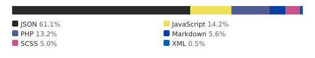

<!-- aidevops:badges:start -->
<!-- managed by aidevops badges; edit the template, not this block -->
<!-- Build & Quality Status -->
[](https://github.com/Ultimate-Multisite/simple-comment-editing/actions/workflows/loc-badge.yml)

<!-- License & Legal -->
[](https://github.com/Ultimate-Multisite/simple-comment-editing/blob/master/LICENSE)

<!-- Repository Metrics -->
[](docs/metrics/repo-metrics.md)
[](docs/metrics/repo-metrics.md)
[](docs/metrics/repo-metrics.md)

<!-- Project Links -->
[](https://github.com/Ultimate-Multisite/simple-comment-editing)
<!-- aidevops:badges:end -->

Simple Comment Editing for WordPress
======================

Simple Comment Editing for WordPress 3.5+

## Description

Simple Comment Editing is a stripped down version of <a href="http://wordpress.org/plugins/wp-ajax-edit-comments/">Ajax Edit Comments</a>.

The biggest differences:
<ol>
<li>Only anonymous users (and logged in users who don't have permission to edit comments) can edit their comments for a period of time (the default is 5 minutes).</li>
<li>There are no styles included with this plugin.  For most themes, the appearance is acceptable.  For advanced customization, see the "Styles" section.</li>
<li>Settings control the editing timer, labels, deletion behavior, and optional Quicktags toolbar. Some defaults can also be overwritten using filters.</li>
</ol>

## Installation

1. Just unzip and upload the "simple-comment-editor" folder to your '/wp-content/plugins/' directory
2. Activate the plugin through the 'Plugins' menu in WordPress

## Development testing

PHPUnit integration tests target PHP 7.4+ and run against real WordPress users,
comments, AJAX handlers, and a disposable database. See [tests/README.md](tests/README.md)
for setup, commands, the compatibility matrix, and coverage instructions.

## Translations

Bundled translations provide the default frontend labels and countdown text when
no WordPress.org language pack is installed, including German and German Formal.
WordPress.org and Loco translations can still override the bundled defaults.
Labels customized in Settings are saved site values, so they are not translated
automatically; update those saved values directly when changing site languages.

## Optional editor integrations

Plain-text textarea editing remains the default. To add WordPress's native HTML
toolbar, enable **Quicktags Toolbar** in **Settings → Simple Comment Editing**.
The option loads WordPress's Quicktags assets only on pages where SCE loads and
creates one editor per open comment. It does not add TinyMCE, CKEditor, or any
third-party editor dependency.

External editors can use the textarea lifecycle instead. Leave Quicktags
disabled for that textarea, then register actions with an application-specific
`wp.hooks` namespace. Each action receives one object with `textarea`,
`commentId`, and `postId`; reset also receives the previously saved `content`.

```js
const namespace = 'my-plugin/comment-editor';
const editors = new Map();

wp.hooks.addAction( 'sce.comment.editor.show', namespace, ( { textarea, commentId } ) => {
	editors.set( commentId, mountMyEditor( textarea, textarea.value ) );
} );

wp.hooks.addAction( 'sce.comment.editor.save.pre', namespace, ( { textarea, commentId } ) => {
	textarea.value = editors.get( commentId ).getContent();
} );

wp.hooks.addAction( 'sce.comment.editor.reset', namespace, ( { content, commentId } ) => {
	editors.get( commentId ).setContent( content );
} );

wp.hooks.addAction( 'sce.comment.editor.destroy', namespace, ( { commentId } ) => {
	editors.get( commentId ).destroy();
	editors.delete( commentId );
} );
```

`sce.comment.editor.save.pre` runs before SCE reads the textarea, so an adapter
must synchronously copy its editor value there. The same lifecycle is also
emitted as document events: `sceEditTextareaShow`, `sceCommentSavePre`,
`sceCommentEditorReset`, `sceCommentEditorDestroy`, and
`sceCommentQuicktagsInit`. The existing `sceCommentSavePost` event remains
available after a successful save.

## Troubleshooting cache, proxy, migration, and inline controls

SCE only loads its frontend assets on singular content where its server-side
cookie and permission checks allow editing. It initializes the controls that
are present when the page `load` event fires. A cache, optimization plugin,
proxy, migration, or dynamically replaced comment list can therefore make an
otherwise valid installation appear broken. These checks isolate the observed
failure; they do not establish a historical support report's root cause.

### Start with browser evidence

Use a private/incognito window with the browser developer tools open, then
leave a new test comment and reload the page. Test as the commenter, not as an
administrator, and remove the test comment afterwards.

1. **No edit markup:** inspect the rendered comment for `.sce-edit-comment`
   and `.sce-edit-button`. If those elements are absent, capture the page URL,
   the comment status, the visitor's login state, and the timer/settings in
   effect. A custom comment loop must call WordPress's `comment_text()` path;
   copying `comment_content` omits SCE's generated controls.
2. **Markup is present but JavaScript is missing or errors:** in the Network
   and Console panels, confirm that `dist/sce-editing.js` returns JavaScript
   (not an HTML error page) and that `wp-i18n` and `wp-hooks` load before it.
   When Quicktags Toolbar is enabled, `wp-editor` must also load first. Record
   the first console error and the response/status for the failed asset.
3. **Controls are hidden or disappear:** inspect the timer request and its
   response before changing settings. SCE intentionally removes controls when
   the server says the commenter cannot edit or the timer has expired. Do not
   expose those controls with cached markup or client-side changes: the server
   must continue to enforce nonce and comment-ownership checks.
4. **Save or delete fails:** inspect the `admin-ajax.php` request, its status,
   and its response while preserving the current comment text. Verify that the
   request uses the current site's HTTP/HTTPS origin and carries the commenter's
   cookies and nonce. A 403/nonce/auth response is not a reason to disable
   anti-spam or other security protections.
5. **A server error occurs:** obtain the complete exception and stack trace
   from the server's WordPress/PHP error log, along with WordPress, PHP, theme,
   SCE, and active cache/optimization-plugin versions. Do not post cookies,
   nonces, full request bodies, credentials, or private comment content in a
   public support thread.

If another plugin replaces or lazy-loads comments after the original page load,
use its documented integration point to call the existing
`window.initEditCommentButton( button )` for each new `.sce-edit-button`. The
built-in Ajaxify Comments callback already performs that reinitialization.

### Cache and optimization isolation

Purge every relevant layer before each retest: the WordPress/cache-plugin cache,
the reverse-proxy or CDN cache, and the browser cache. Then test one change at
a time and re-enable it after recording the result. Do not serve a shared cache
entry that contains an authenticated or edit-author response to other visitors.

For W3 Total Cache and similar tools, exclude these already-built files from
JavaScript minification, combination, defer/delay rewriting, and re-minification
while testing:

```
dist/sce-editing.js
dist/integrations-admin.js
```

Purge the cache, load a newly created comment as its author, and confirm the
asset responses and timer request again. If that restores the controls, add
optimizations back one at a time to identify the conflicting transform instead
of leaving all optimizations disabled.

For Cloudflare or another proxy, separately test script optimization (including
defer/delay or similar script rewriting), cached HTML, the origin's HTTP/HTTPS
scheme, and client-IP forwarding. These are plausible integration points, not a
known single root cause. Keep the proxy's security and anti-spam controls in
place; make the narrowest documented exclusion needed for the affected asset or
path, then purge and retest.

### After a migration or domain change

Confirm WordPress Address and Site Address use the expected canonical scheme
and host. Compare the page URL and `admin-ajax.php` request origin, then check
the commenter's cookies for the expected domain, path, and secure flag. Clear
old browser cookies and every cache layer before creating a fresh test comment.
If the controls work intermittently, collect a HAR or the failing request's URL,
status, response headers, and first console error with cookies and request
payloads removed.

For a reproducible report, include the smallest standard-theme reproduction,
the exact sequence, the active optimization/proxy settings, versions, and the
privacy-safe browser evidence above. Cross-check dynamic comment replacement
against the initialization guidance above and AJAX failures against the
request/response checks before concluding that SCE itself is at fault.

## Frequently Asked Questions

### Why doesn't this plugin come with any styles?
It's impossible to style an inline comment editor for every theme.  We've included basic HTML markup that is easily stylable to fit your theme.

### Where are the options?
Log in to your Dashboard and open **Settings → Simple Comment Editing**.

### I want to style the editing interface.  Where do I start?
See "Styles" section.

### What Browsers Have You Tested This In?
<ul>
<li>IE 6-10</li>
<li>Latest versions of Chrome, Firefox, and Safari</li>
<li>iOS Safari</li>
</ul>

### What Themes Have You Tested This In?
<ul>
<li>Twenty Ten</li>
<li>Twenty Eleven</li>
<li>Twenty Twelve</li>
<li>Twenty Thirteen</li>
<li>Genesis</li>
<li>Genesis Mindstream</li>
</ul>

## WordPress Filters

### sce_loading_img - Change the loading image
```php
/**
* Filter: sce_loading_img
*
* Replace the loading image with a custom version.
*
* @since 1.0.0
*
* @param string  $image_url URL path to the loading image.
*/
```

Example:

```php
//Simple Comment Editing
add_filter( 'sce_loading_img', 'edit_sce_loading_img' );
function edit_sce_loading_img( $default_url ) {
	return 'http://domain.com/new_loading_image.gif';
}
```

### sce_comment_check_errors - Add custom error messages

```php
/**
* Filter: sce_comment_check_errors
*
* Return a custom error message based on the saved comment
*
* @since 1.2.4
*
* @param bool  $custom_error Default custom error. Overwrite with a string
* @param array $comment_to_save Associative array of comment attributes
*/
```

Here's an example:
```php
add_filter( 'sce_comment_check_errors', 'custom_sce_check_comment_length', 15, 2 );
function custom_sce_check_comment_length( $return = false, $comment = array() ) {
	$comment_content = trim( wp_strip_all_tags( $comment[ 'comment_content' ] ) );
	$comment_length = strlen( $comment_content );
	if ( $comment_length < 50 ) {
		return 'Comment must be at least 50 characters';
	}
	return false;
}

```

### sce_allow_delete - Whether to allow comment deletion or not

```php
/**
* Filter: sce_allow_delete
*
* Determine if users can delete their comments
*
* @since 1.1.0
*
* @param bool  $allow_delete True allows deletion, false does not
*/
```

Example: 

```php
// Disable delete functionality
add_filter( 'sce_allow_delete', '__return_false' );
```

### sce_allow_delete_confirmation - Whether to show a delete confirmation or not

```php
/**
 * Filter: sce_allow_delete_confirmation
 *
 * Boolean to decide whether to show a delete confirmation
 *
 * @since 2.1.7
 *
 * @param bool true to show a confirmation, false if not
 */
```

Example:

```php
add_filter( 'sce_allow_delete_confirmation', '__return_false' );
```

### sce_get_comment - Add extra data to the comment object 

This is only used when retrieving a comment via Ajax and can be used by third-party plugins who post comments using Ajax

```php
/**
* Filter: sce_get_comment
*
* Modify comment object
*
* @since 1.5.0
*
* @param object Comment Object
*/
```

### sce_extra_fields - Add extra HTML to the editing interface 
```php
/**
* Filter: sce_extra_fields
*
* Filter to add additional form fields
*
* @since 1.4.0
*
* @param string Empty string
* @param int post_id POST ID
* @param int comment_id Comment ID
*/
```

### Custom fields that stay with the edited comment

Use `sce_extra_fields_pre` when a field belongs before the comment textarea;
use `sce_extra_fields` for fields after it. Both filters receive the post and
comment IDs, and `sce_extra_fields_pre` also receives the current comment. Give
each field an ID derived from `$comment_id`, then read it from that comment's
editor in the JavaScript filter. This prevents two open editors from sharing a
field value.

The example below adds an optional title and a 1–5 rating. It uses the current
WordPress hooks signature—`wp.hooks.addFilter( name, namespace, callback )`—and
only adds values to the request when their fields exist and are non-empty.

```php
add_filter( 'sce_extra_fields_pre', function( $content, $post_id, $comment_id, $comment ) {
	$title  = (string) get_comment_meta( $comment_id, '_my_sce_title', true );
	$rating = absint( get_comment_meta( $comment_id, '_my_sce_rating', true ) );

	return sprintf(
		'<p><label for="my-sce-title-%1$d">Title</label> <input id="my-sce-title-%1$d" class="my-sce-title" type="text" value="%2$s" maxlength="120" /></p><p><label for="my-sce-rating-%1$d">Rating</label> <input id="my-sce-rating-%1$d" class="my-sce-rating" type="number" min="1" max="5" value="%3$d" /></p>',
		absint( $comment_id ),
		esc_attr( $title ),
		$rating
	);
}, 10, 4 );

add_action( 'sce_save_after', function( $comment_to_save, $post_id, $comment_id ) {
	if ( isset( $_POST['my_sce_title'] ) ) {
		$title = sanitize_text_field( wp_unslash( $_POST['my_sce_title'] ) );
		if ( '' !== $title && strlen( $title ) <= 120 ) {
			update_comment_meta( $comment_id, '_my_sce_title', $title );
		}
	}

	if ( isset( $_POST['my_sce_rating'] ) ) {
		$rating = absint( wp_unslash( $_POST['my_sce_rating'] ) );
		if ( $rating >= 1 && $rating <= 5 ) {
			update_comment_meta( $comment_id, '_my_sce_rating', $rating );
		}
	}
}, 10, 3 );
```

```js
wp.hooks.addFilter(
	'sce.comment.save.data',
	'my-plugin/comment-fields',
	( ajaxSaveParams ) => {
		const editor = document.querySelector( `#sce-edit-comment${ ajaxSaveParams.comment_id }` );
		if ( ! editor ) {
			return ajaxSaveParams;
		}

		const title = editor.querySelector( '.my-sce-title' );
		const rating = editor.querySelector( '.my-sce-rating' );
		if ( title && title.value.trim() ) {
			ajaxSaveParams.my_sce_title = title.value.trim();
		}
		if ( rating && rating.value ) {
			ajaxSaveParams.my_sce_rating = rating.value;
		}

		return ajaxSaveParams;
	}
);
```

SCE performs its normal nonce and comment-ownership checks before
`sce_save_after` runs. The callback must still sanitize and validate every
request value. Do not delete or overwrite existing metadata when an optional
field is absent: that can happen when a theme does not render the extra field.

### Custom comment loops

SCE attaches its editor through WordPress's native `comment_text` filter. A
custom loop should call `comment_text( $comment )` rather than echoing
`$comment->comment_content`; the latter bypasses formatting and the editor.

```php
foreach ( get_comments( array( 'post_id' => get_the_ID() ) ) as $comment ) {
	?>
	<article id="comment-<?php echo esc_attr( $comment->comment_ID ); ?>" <?php comment_class( '', $comment ); ?>>
		<?php comment_text( $comment ); ?>
	</article>
	<?php
}
```

Keep the comment object available to `comment_text()` and do not manually copy
SCE's nonce, AJAX URL, or controls. SCE supplies them only when the current
visitor may edit that specific comment.

### sce_buttons - Add extra buttons to the editing interface (aside from Cancel and Save)
```php
/**
* Filter: sce_buttons
*
* Filter to add button content
*
* @since 1.3.0
*
* @param string  $textarea_buttons Button HTML
* @param int       $comment_id        Comment ID
*/
```

`sce_buttons` receives the complete generated button markup, so use it for
safe, intentional HTML additions such as an icon or a help link. The
`sce_text_save`, `sce_text_cancel`, and `sce_text_delete` filters are for text
labels; SCE escapes their values before rendering.

```php
add_filter( 'sce_buttons', function( $buttons, $comment_id ) {
	return $buttons . '<span class="my-sce-help" data-comment-id="' . absint( $comment_id ) . '">Need help?</span>';
}, 10, 2 );
```

### sce_content - Modify the edit output HTML
```php
/**
* Filter: sce_content
*
* Filter to overral sce output
*
* @since 1.3.0
*
* @param string  $sce_content SCE content 
* @param int       $comment_id Comment ID of the comment
*/
```

### sce_save_before - Modify the comment object before saving via AJAX
```php
/**
* Filter: sce_save_before
*
* Allow third parties to modify comment
*
* @since 1.4.0
*
* @param object $comment_to_save The Comment Object
* @param int $post_id The Post ID
* @param int $comment_id The Comment ID
*/
```

### sce_can_edit - Override the boolean whether a user can edit a comment or not
```php
/**
* Filter: sce_can_edit
*
* Determine if a user can edit the comment
*
* @since 1.3.2
*
* @param bool  true If user can edit the comment
* @param object $comment Comment object user has left
* @param int $comment_id Comment ID of the comment
* @param int $post_id Post ID of the comment
*/
```

Example: https://gist.github.com/ronalfy/6b4fec8b3ac55bc47f3f

### sce_security_key_min - How many security keys will be stored as post meta
```php
/**
* Filter: sce_security_key_min
*
* Determine how many security keys should be stored as post meta before garbage collection
*
* @since 1.0.0
*
* @param int  $num_keys How many keys to store
*/
```

### sce_load_scripts - Whether to load SCE scripts or not
```php
/**
* Filter: sce_load_scripts
*
* Boolean to decide whether to load SCE scripts or not
*
* @since 1.5.0
*
* @param bool  true to load scripts, false not
*/
```

### sce_comment_time - How long in minutes to allow comment editing
```php
/**
* Filter: sce_comment_time
*
* How long in minutes to edit a comment
*
* @since 1.0.0
*
* @param int  $minutes Time in minutes
*/
```
Example:

```php
//Simple Comment Editing
add_filter( 'sce_comment_time', 'edit_sce_comment_time' );
function edit_sce_comment_time( $time_in_minutes ) {
	return 60;
}
```

### sce_show_timer - Show or hide the timer
```php
/**
 * Filter: sce_show_timer
 *
 * Filter allow you to hide the timer
 *
 * @since 2.3.0
 *
 * @param bool Whether to show the timer or not
 */
```
Example:

```php
//Simple Comment Editing - Disable the timer
add_filter( 'sce_show_timer', '__return_false' );
```

### sce_edit_text - Change the "Click to Edit" text.

```php
/**
* Filter: sce_text_edit
*
* Filter allow editing of edit text
*
* @since 2.0.0
*
* @param string Translated click to edit text
*/
```

Example:

```php
add_filter( 'sce_text_edit', function( $translated_text ) {
	return "Custom Edit Text";
} );
```

### sce_edit_save - Change the "Save" button text.

```php
/**
* Filter: sce_text_save
*
* Filter allow editing of save text
*
* @since 2.0.0
*
* @param string Translated save text
*/
```

Example: 

```php
add_filter( 'sce_text_save', function( $translated_text ) {
	return "Custom Save";
} );
```

### sce_edit_cancel - Change the "Cancel" button text.

```php
/**
* Filter: sce_text_cancel
*
* Filter allow editing of cancel text
*
* @since 2.0.0
*
* @param string Translated cancel text
*/

```

Example: 

```php
add_filter( 'sce_text_cancel', function( $translated_text ) {
	return "Custom Cancel";
} );
```

### sce_edit_delete - Change the "Delete" button text.

```php
/**
* Filter: sce_text_delete
*
* Filter allow editing of delete text
*
* @since 2.0.0
*
* @param string Translated delete text
*/

```

Example: 

```php
add_filter( 'sce_text_delete', function( $translated_text ) {
	return "Custom Delete";
} );
```

## WordPress Actions

### sce_save_after - Triggered via Ajax after a comment has been saved

Useful for custom comment fields

```php
/**
* Action: sce_save_after
*
* Allow third parties to save content after a comment has been updated
*
* @since 1.4.0
*
* @param object $comment_to_save The Comment Object
* @param int $post_id The Post ID
* @param int $comment_id The Comment ID
*/
```

## JavaScript Events

### sce.comment.save.pre - Before a comment is submitted via Ajax

```php
/**
* Event: sce.comment.save.pre
*
* Event triggered before a comment is saved
*
* @since 1.4.0
*
* @param int $comment_id The Comment ID
* @param int $post_id The Post ID
*/
```

### sce.comment.save - After a comment has been saved via Ajax

```php
/**
* Event: sce.comment.save
*
* Event triggered after a comment is saved
*
* @since 1.4.0
*
* @param int $comment_id The Comment ID
* @param int $post_id The Post ID
*/
```

### sce.timer.loaded - After a timer has been loaded

```php
/**
* Event: sce.timer.loaded
*
* Event triggered after a commen's timer has been loaded
*
* @since 1.3.0
*
* @param jQuery Element of the comment
*/
```

### sce.comment.loaded - After a comment has been loaded via Ajax

This hook is useful for third-party plugins who post comments via Ajax.

```php
/**
* Event: sce.comment.loaded
*
* Event triggered after SCE has loaded a comment.
*
* @since 1.5.0
*
* @param object Comment Object
*/
```

## JavaScript Hooks

JS hooks are using WP-JS-Hooks: https://github.com/carldanley/WP-JS-Hooks

Please use handle *wp-hooks* when enqueueing for consistency and to prevent conflicts.

### sce.comment.save.data - Before a comment is submitted via Ajax

Used to modify POST object before being sent via Ajax. This is useful for adding extra fields.

```php
/**
* JSFilter: sce.comment.save.data
*
* Event triggered before a comment is saved
*
* @since 1.4.0
*
* @param object $ajax_save_params
*/
```

### sce.comment.timer.text - Before a timer is outputted in JavaScript.

Used to modify timer output.

```php
/**
* JSFilter: sce.comment.timer.text
*
* Filter triggered before a timer is returned
*
* @since 1.4.0
*
* @param string Timer text
* @param string Minutes text (internationalized)
* @param string Seconds text (internationalized)
* @param int minutes
* @param int seconds
*/
```

Example placed in `functions.php`:

```php
add_action( 'wp_footer', function() {
    ?>
    <script type="text/javascript">
        jQuery( document ).ready( function( $ ) {
            /* Will give you format of minutes:seconds (e.g., 2:58) */
            if (typeof wp.hooks != 'undefined') {
                wp.hooks.addFilter( 'sce.comment.timer.text', function( timer_text, minutes_text, seconds_text, minutes, seconds ) {
                    timer_text = '&nbsp;&nbsp;&nbsp;&nbsp;' + minutes;
                    timer_text += ":";
                    if (seconds >= 0) {
            			if( seconds < 10 ) {
            				timer_text += '' + '0' + seconds;	
                        } else {
                          timer_text += seconds;  
                        }
                    }
                    return timer_text;
                } );
            }    
        } );
    </script>
    <?php
} );

```


## Styling
The plugin doesn't come with any styles.  We leave it up to you to style the interface.  It doesn't look horribly ugly on most themes, but we leave the advanced customization up to you.

### Styling the Edit Interface
The overall editing interface has been wrapped in a `div` with class `sce-edit-comment`.

```css
.sce-edit-comment { /* styles here */ }
```

### Styling the Edit Button
The edit button and timer have been wrapped in a `div` with class `sce-edit-button`.

```css
.sce-edit-button { /* styles here */ }
.sce-edit-button a { /* styles here */ }
.sce-edit-button .sce-timer { /* styles here */ }
```

### Styling the Loading Icon
The loading icon has been wrapped in a `div` with class `sce-loading`.
```css
.sce-loading { /* styles here */ }
.sce-loading img { /* styles here */ }
```

### Styling the Textarea
The textarea interface has been wrapped in a `div` with class `sce-textarea`.

The actual `textarea` has been wrapped in a `div` with class `sce-comment-textarea`.
The save/cancel buttons have been wrapped in a `div` with class `sce-comment-edit-buttons`.

```css
.sce-textarea { /* styles here */ }
.sce-textarea .sce-comment-textarea textarea { /* styles here */ }
.sce-comment-edit-buttons { /* styles here */ }
.sce-comment-edit-buttons .sce-comment-save { /* styles here */ }
.sce-comment-edit-buttons .sce-comment-cancel { /* styles here */ }
```

For an inline WP ULike-style action row, style the existing wrapper instead of
moving controls outside it. SCE's JavaScript expects `.sce-edit-comment` to
contain `.sce-textarea`, `.sce-comment-text`, and
`.sce-comment-edit-buttons`.

```css
.sce-edit-comment .sce-comment-edit-buttons {
	display: inline-flex;
	align-items: center;
	gap: 0.5rem;
}

.sce-edit-comment .sce-comment-edit-buttons-group {
	display: inline-flex;
	gap: 0.25rem;
}
```

This keeps Save, Cancel, Delete, and the timer inside their required hierarchy
and preserves their native button behavior. Do not replace the buttons with
links to `admin-ajax.php` or move them into arbitrary theme markup.

### Styling the Status Message
The status message has been wrapped in a `div` with class `sce-status`.

Here's some sample styles that mimic how error messages are displayed in the WordPress admin area:

```css
.sce-status {
	border-left: 4px solid #FFF;
	-webkit-box-shadow: 0 1px 1px 0 rgba( 0, 0, 0, 0.1 );
	box-shadow: 0 1px 1px 0 rgba( 0, 0, 0, 0.1 );
	background: #fff;
	color: #333;
	padding: 10px;	
	margin-top: 10px;
}
.sce-status.error {
	border-color: #dd3d36;
}
.sce-status.updated {
	border-color: #7ad03a;
}
```

### Testing the Styles
Since most of the interface is hidden, it's a little hard to style.  Just place this into your stylesheet, and remove when you're done.
```css
/* todo - remove me when done styling */
.sce-edit-button,
.sce-loading,
.sce-textarea {
	display: block !important;
}
```
Have fun leaving lots of test comments :) - Recommended is to use the filter (in the FAQ section) to temporarily increase the comment editing time.  Make sure you leave the test comments when you're not logged in.

<!-- aidevops:managed-readme:start -->
<!-- managed by aidevops; refresh with managed-readme-helper.sh sync -->
## Star History


## Built with aidevops

This project was created and is maintained with
[aidevops.sh](https://aidevops.sh).

[View Ultimate-Multisite on GitHub](https://github.com/Ultimate-Multisite) ·
[aidevops repository](https://github.com/marcusquinn/aidevops)
<!-- aidevops:managed-readme:end -->
